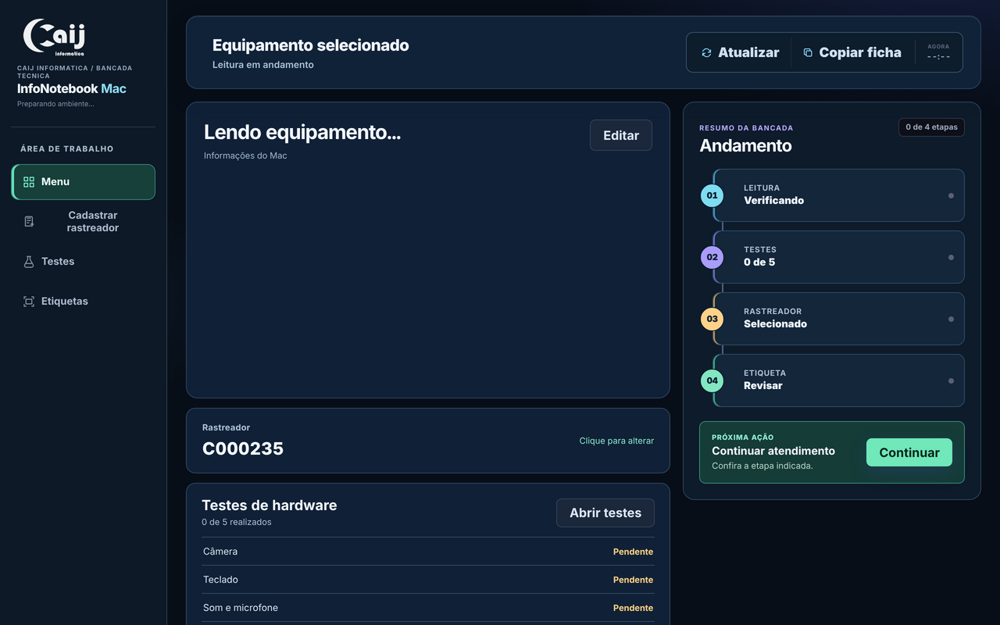
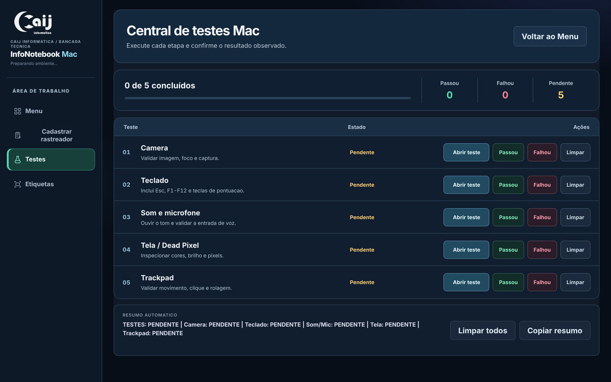
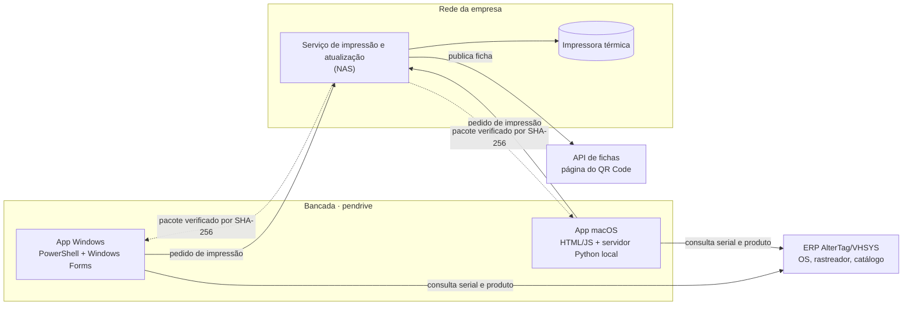

# InfoMachine

  

**App de bancada que conduz a triagem de cada equipamento, da leitura do hardware à etiqueta impressa.**

Desenvolvido para a CAIJ Informática, onde cerca de **100 máquinas por semana** passam pelo fluxo completo. Roda a partir de pendrives, sem instalação, em Windows e macOS.

> Antes chamado InfoNotebook e CAIJ_Info; alguns arquivos ainda usam esses nomes.



<table>
  <tr>
    <td width="50%"></td>
    <td width="50%"></td>
  </tr>
  <tr>
    <td align="center"><sub>Central de testes</sub></td>
    <td align="center"><sub>Prévia e revisão da etiqueta</sub></td>
  </tr>
</table>

<sub>Capturas da versão macOS em modo de prévia, com valores de exemplo.</sub>

## O problema

Preparar uma máquina exigia juntar informação de vários lugares: ler a configuração, conferir a serial, descobrir se o equipamento já tinha rastreador, achar o produto certo no catálogo, testar, descrever o que foi feito e montar a etiqueta. Feito à mão, isso deixava a bancada lenta e abria espaço para associar a máquina ao registro errado ou imprimir dados incompletos.

## O que o app faz

| Etapa | Como funciona |
|:--|:--|
| **Leitura do equipamento** | Coleta modelo, serial, processador, memória, armazenamento, GPU e bateria. Trata múltiplos discos (`256GB SSD + 500GB HDD`), HDD reportado como SSD e valores `Unknown` de BIOS antigas. Também lê iPhones via USB. |
| **Histórico por serial** | Consulta rastreadores anteriores da mesma serial no ERP. Se houver mais de um, mostra as opções e deixa o técnico decidir. |
| **Testes de hardware** | Câmera, teclado, som e microfone, tela e touchpad, cada um pendente, aprovado ou reprovado. O teste de teclado segue o layout físico do modelo. |
| **Cadastro** | Técnico, produto do catálogo, configuração, classificação (grade) e serviços realizados, com observações pré-preenchidas. |
| **Etiqueta** | Prévia proporcional à etiqueta térmica de 80 × 50 mm e impressão pelo serviço no NAS, que também publica a ficha acessada pelo QR Code. |
| **Atualização** | Pacotes publicados no NAS, verificados por SHA-256 e com backup antes da troca, para manter os pendrives da equipe na mesma versão. |

## Arquitetura



## Decisões técnicas

- **Leitura automática como sugestão, não como verdade.** BIOS e Windows nem sempre descrevem bem o hardware (RAM soldada, posições de memória, tipo de disco). Todo campo lido pode ser corrigido antes de imprimir.
- **A decisão ambígua fica com quem está com a máquina.** Quando uma serial tem mais de um rastreador, o app não escolhe sozinho. Ele também sinaliza quando a serial da máquina diverge da serial da OS selecionada.
- **Respostas atrasadas são descartadas.** Se o técnico troca a serial enquanto uma consulta está em andamento, o resultado antigo não sobrescreve o atual.
- **Atualização verificável.** Código no GitHub, pacote no NAS e versão em cada pendrive são três estados diferentes. O hash garante que o pendrive roda exatamente o que foi publicado.
- **A etiqueta física é a confirmação final.** Uma resposta positiva da API não garante que a etiqueta saiu; o diagnóstico de conexão separa falhas do NAS, da publicação do QR e da impressora.
- **Credenciais fora do código.** Chaves do ERP e da API de fichas são lidas de arquivos locais e variáveis de ambiente.

## Estrutura

```text
InfoNotebook.bat / .vbs        Entrada no Windows
InfoNotebookMac.command        Entrada no macOS
CoreCAIJ/
  InfoNotebook.ps1             App Windows (leitura, testes, cadastro, etiqueta)
  ServidorImpressao.ps1        Serviço do NAS: impressão, QR e atualização
  ServidorImpressaoWatchdog.ps1  Supervisão do serviço
  AtualizarCAIJ.ps1            Atualização dos pendrives a partir do NAS
  PublicarAtualizacao.ps1      Gera e publica o pacote verificado
  mac-ui/                      Interface macOS (HTML, CSS, JS) e servidor Python local
  *.Tests.ps1 / .cjs / .py     Testes (26 arquivos)
```

## Testes

```bash
# testes de lógica da interface (Node.js 18+), a partir da raiz do repositório
for f in CoreCAIJ/*.Tests.cjs; do node "$f"; done

# servidor local do macOS
python3 CoreCAIJ/SerialOsMac.Tests.py

# testes PowerShell (Windows, PowerShell 5.1+ ou pwsh)
Get-ChildItem CoreCAIJ/*.Tests.ps1 | ForEach-Object { & $_.FullName }
```

Os testes cobrem a decisão entre rastreadores por serial, formatação de armazenamento e RAM, regras de classificação, montagem da etiqueta, atualização por hash e desempenho de inicialização e conexão.

## Como executar

O app depende da infraestrutura da empresa (ERP e serviço no NAS) e não funciona fora dela sem configuração. Para explorar a interface:

```bash
# macOS: interface web com servidor local (abre no navegador)
mkdir -p /tmp/infomachine-data
python3 CoreCAIJ/mac-ui/server.py --core CoreCAIJ --data /tmp/infomachine-data
```

No Windows, `TestarInterfaceWindows.bat` abre a prévia da interface sem acessar a rede.

## Limitações conhecidas

- Algumas teclas, como `Fn` e `Prt Sc`, são interceptadas pelo sistema operacional e nem sempre podem ser detectadas pelo teste de teclado.
- Informações físicas, como RAM soldada e posições dos pentes, ainda exigem conferência visual.
- Ainda não há medição formal do tempo por máquina antes e depois do app.

## Autoria

Projeto conduzido por **Vitor Tosti**: levantamento das necessidades, definição do comportamento, implementação e testes em equipamentos reais. Desenvolvido com apoio de assistente de código (Codex), com cada mudança validada na bancada.
